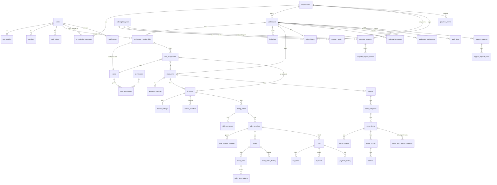

# Database Schema

PostgreSQL 18 (PGlite 0.5 locally and in tests is PostgreSQL 18 too), managed with Drizzle ORM. Source of truth: `packages/database/src/providers/postgres/schema/*.ts`; SQL migrations in `packages/database/src/providers/postgres/migrations/` (generate with `pnpm db:generate`, or `pnpm --filter @ros/database exec drizzle-kit generate --custom --name <name>` for SQL-only ones; apply with `pnpm db:migrate`). Reference data (permission catalog, system roles, default plans, default platform settings) is synced idempotently by `ensureSystemData()` at every API start and in `db:migrate`.

Conventions: UUID primary keys (`gen_random_uuid()`); `created_at`/`updated_at` timestamptz; money = `bigint` minor units; rates = integer basis points; `version` integer for optimistic concurrency; `deleted_at` soft delete where history references rows (restaurants, branches, menu, tables); status columns are `text` with `CHECK` constraints (easy to evolve, no enum migrations).

## Entity-relationship overview

## Tables by area

| Area              | Tables                                                                                                               | Notes                                                                                                                                                                                                           |
| ----------------- | -------------------------------------------------------------------------------------------------------------------- | --------------------------------------------------------------------------------------------------------------------------------------------------------------------------------------------------------------- |
| Identity          | `users`, `user_profiles`, `sessions`, `auth_tokens`                                                                  | email unique + lowercase check; token/session hashes unique                                                                                                                                                     |
| Organizations     | `organizations`, `organization_members`                                                                              | billing owner of workspaces and the current subscription; `status` ACTIVE / SUSPENDED; `max_workspaces_override` (Super Admin); members are OWNER or BILLING_ADMIN, unique per (organization, user)             |
| Tenancy & access  | `workspaces`, `workspace_memberships`, `roles`, `permissions`, `role_permissions`, `role_assignments`, `invitations` | `role_assignments` is the RestaurantMembership: restaurant-wide (branch null) or single branch. System roles have `workspace_id` null. One pending invitation per email per workspace.                          |
| Restaurants       | `restaurants`, `restaurant_settings`, `branches`, `branch_settings`, `branch_counters`                               | branch code unique per restaurant (live rows); counters give per-branch order/bill numbers                                                                                                                      |
| Menu              | `menus`, `menu_categories`, `menu_items`, `menu_variants`, `addon_groups`, `addons`, `menu_item_branch_overrides`    | restaurant-level menu; per-branch price/availability overrides (null = inherit); price ≥ 0 checks; add-on min/max checks                                                                                        |
| Tables & sessions | `dining_tables`, `table_qr_tokens`, `table_sessions`, `table_session_members`                                        | `table_sessions_one_open_uq` (one non-closed session per table); `table_qr_tokens_active_uq` (one ACTIVE token per table); token hash unique                                                                    |
| Orders            | `orders`, `order_items`, `order_item_addons`, `order_status_history`                                                 | unique `(branch_id, order_number)` and `(branch_id, idempotency_key)`; item names/prices/variants/add-ons snapshotted                                                                                           |
| Billing           | `bills`, `bill_items`, `payments`, `payment_history`                                                                 | `bills_session_live_uq` (one non-void bill per session); tax breakdown/discount/service charge snapshotted; payments are an append-only ledger with unique `(branch_id, idempotency_key)`; amount > 0 check     |
| Subscriptions     | `subscription_plans`, `subscriptions`, `subscription_events`, `workspace_entitlements`, `platform_settings`          | one current subscription per organization (`subscriptions_current_org_uq`); `workspace_id` kept and dual-written; plans store limits/features as JSON validated by Zod, plus `max_workspaces` (null = fair use) |
| Payments          | `payment_orders`, `payment_events`                                                                                   | one row per prepaid checkout (`CREATED` / `PAID` / `FAILED` / `EXPIRED`), unique `(provider, provider_order_id)`; webhook events deduplicated by unique `(provider, event_id)`                                  |
| Platform          | `announcements`, `support_requests`, `support_request_notes`, `audit_logs`                                           | audit metadata must be non-sensitive                                                                                                                                                                            |
| Notifications     | `notifications`, `notification_preferences`, `push_subscriptions`, `email_outbox`                                    |                                                                                                                                                                                                                 |
| Infrastructure    | `idempotency_records`, `rate_limit_buckets`, `stored_files`                                                          |                                                                                                                                                                                                                 |

## Key indexes

Tenant lookups lead with `workspace_id`: e.g. `orders(workspace_id, branch_id, status, created_at)`, `bills(workspace_id, branch_id, payment_status, issued_at)`, `payments(workspace_id, branch_id, created_at)`, `menu_items(workspace_id, category_id, sort_order)`, `audit_logs(workspace_id, created_at)`.

## Transactions

Order placement (counter + order + lines + history + notifications), order transitions (conditional update + history + audit), bill generation (session lock + bill + lines + session status), payment recording (bill lock + ledger + recomputed balance + history), session closure and subscription changes are each a single transaction.

## Retention

No automatic deletion. Expired workspaces keep all data (read-only access). Deletion on request is a separate, audited process (see `deployment.md` → Data retention).

## Upgrade requests (migration `0001_upgrade_requests`)

`upgrade_requests`: workspace, requester, current plan (at request time), requested plan, billing cycle, optional message, `status` (`PENDING` / `APPROVED` / `REJECTED` / `CANCELLED`, CHECK-constrained), decider, `decided_at`, `decision_reason` (rejection reason), `applied_subscription_id` (the subscription created on approval). The partial unique index `upgrade_requests_one_pending_uq` allows one `PENDING` request per workspace. The status is moved with a conditional `UPDATE … WHERE status = 'PENDING'`, so a request is decided exactly once even with two admins clicking at the same time.

`upgrade_request_events`: append-only history (`CREATED`, `NOTE`, `APPROVED`, `REJECTED`, `CANCELLED`) with actor and text. `NOTE` rows are internal and are only returned by admin endpoints.

This replaces the earlier approach of filing upgrades as support tickets; `support_requests` rows with category `UPGRADE` from before the migration remain readable by Super Admin but are no longer created.

## Migrations

| File                                  | What                                                                                                                                                                                                                                                                                                                 | Down script (`migrations-down/`)                                                                                                                                            |
| ------------------------------------- | -------------------------------------------------------------------------------------------------------------------------------------------------------------------------------------------------------------------------------------------------------------------------------------------------------------------- | --------------------------------------------------------------------------------------------------------------------------------------------------------------------------- |
| `0000_init`                           | full schema                                                                                                                                                                                                                                                                                                          | —                                                                                                                                                                           |
| `0001_upgrade_requests`               | upgrade requests and their events                                                                                                                                                                                                                                                                                    | —                                                                                                                                                                           |
| `0002_tenant_rls`                     | `ros_tenant` / `ros_runtime` roles, grants, `app_current_workspace()` / `app_current_user()`, `ENABLE ROW LEVEL SECURITY` and policies on every tenant table (hand-written, idempotent)                                                                                                                              | drops policies, disables RLS                                                                                                                                                |
| `0003_organizations`                  | `organizations`, `organization_members`, nullable `workspaces.organization_id` and `subscriptions.organization_id`; backfill (one organization per workspace, same uuid); RLS for both tables                                                                                                                        | RLS part only                                                                                                                                                               |
| `0004_trial_and_workspace_limits`     | `subscription_plans.max_workspaces` (Pro 3, Enterprise null); trial settings 30 → 15 days and reminders `[7,15,25]` → `[7,12,14]` only where still at the old defaults                                                                                                                                               | —                                                                                                                                                                           |
| `0005_payments`                       | `payment_orders`, `payment_events` and their RLS                                                                                                                                                                                                                                                                     | RLS part only                                                                                                                                                               |
| `0008_payment_order_analytics_opt_in` | nullable `payment_orders.analytics_client_id`: the buyer's GA4 client id, stored at checkout only if they opted in to analytics, used only within 48 hours, cleared when the order is paid or by the next cleanup run (`jobs/subscriptions`, hourly) after 48 hours ([growth analytics](growth/analytics-events.md)) | drops the column; **only after rolling the API back to a version before `be4daad`** (current code names the column in every `payment_orders` query and the checkout insert) |

Migrations are additive: no column, table or constraint is dropped, and every hand-written statement is idempotent. `0000`–`0005` and their `meta/` snapshots are history already applied to existing data; never edit them, add a new migration instead. A persistent PGlite directory is never migrated on API startup: the API refuses to start with pending migrations, and `pnpm db:migrate` snapshots the directory first (see [local data preservation](runbooks/local-data-preservation.md)).

## Row-level security

Every table with `workspace_id` (listed in `packages/database/src/providers/postgres/tenant-tables.ts`) has RLS enabled (not forced) with a `tenant_isolation` policy for `ros_tenant` and a `runtime_access` policy for `ros_runtime`. See [tenant security](tenant-security.md#database-level-isolation-row-level-security) for the full model.
