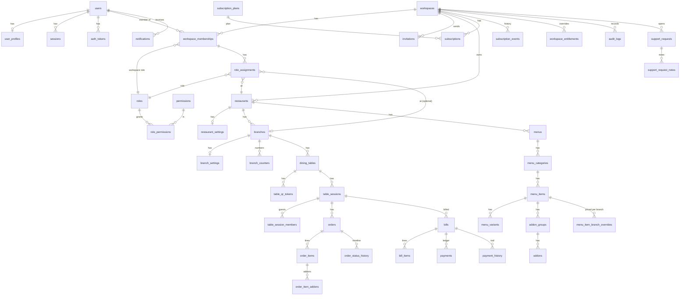

# Database Schema

PostgreSQL 16, managed with Drizzle ORM. Source of truth: `src/infrastructure/database/providers/postgres/schema/*.ts`; SQL migrations in `.../postgres/migrations/` (generate with `pnpm db:generate`, apply with `pnpm db:migrate`). Reference data (permission catalog, system roles, default plans, default platform settings) is synced idempotently by `ensureSystemData()` on startup and in `db:migrate`.

Conventions: UUID primary keys (`gen_random_uuid()`); `created_at`/`updated_at` timestamptz; money = `bigint` minor units; rates = integer basis points; `version` integer for optimistic concurrency; `deleted_at` soft delete where history references rows (restaurants, branches, menu, tables); status columns are `text` with `CHECK` constraints (easy to evolve, no enum migrations).

## Entity-relationship overview

## Tables by area

| Area              | Tables                                                                                                               | Notes                                                                                                                                                                                                       |
| ----------------- | -------------------------------------------------------------------------------------------------------------------- | ----------------------------------------------------------------------------------------------------------------------------------------------------------------------------------------------------------- |
| Identity          | `users`, `user_profiles`, `sessions`, `auth_tokens`                                                                  | email unique + lowercase check; token/session hashes unique                                                                                                                                                 |
| Tenancy & access  | `workspaces`, `workspace_memberships`, `roles`, `permissions`, `role_permissions`, `role_assignments`, `invitations` | `role_assignments` is the RestaurantMembership: restaurant-wide (branch null) or single branch. System roles have `workspace_id` null. One pending invitation per email per workspace.                      |
| Restaurants       | `restaurants`, `restaurant_settings`, `branches`, `branch_settings`, `branch_counters`                               | branch code unique per restaurant (live rows); counters give per-branch order/bill numbers                                                                                                                  |
| Menu              | `menus`, `menu_categories`, `menu_items`, `menu_variants`, `addon_groups`, `addons`, `menu_item_branch_overrides`    | restaurant-level menu; per-branch price/availability overrides (null = inherit); price ≥ 0 checks; add-on min/max checks                                                                                    |
| Tables & sessions | `dining_tables`, `table_qr_tokens`, `table_sessions`, `table_session_members`                                        | `table_sessions_one_open_uq` (one non-closed session per table); `table_qr_tokens_active_uq` (one ACTIVE token per table); token hash unique                                                                |
| Orders            | `orders`, `order_items`, `order_item_addons`, `order_status_history`                                                 | unique `(branch_id, order_number)` and `(branch_id, idempotency_key)`; item names/prices/variants/add-ons snapshotted                                                                                       |
| Billing           | `bills`, `bill_items`, `payments`, `payment_history`                                                                 | `bills_session_live_uq` (one non-void bill per session); tax breakdown/discount/service charge snapshotted; payments are an append-only ledger with unique `(branch_id, idempotency_key)`; amount > 0 check |
| Subscriptions     | `subscription_plans`, `subscriptions`, `subscription_events`, `workspace_entitlements`, `platform_settings`          | one current subscription per workspace (partial unique); plans store limits/features as JSON validated by Zod                                                                                               |
| Platform          | `announcements`, `support_requests`, `support_request_notes`, `audit_logs`                                           | audit metadata must be non-sensitive                                                                                                                                                                        |
| Notifications     | `notifications`, `notification_preferences`, `push_subscriptions`, `email_outbox`                                    |                                                                                                                                                                                                             |
| Infrastructure    | `idempotency_records`, `rate_limit_buckets`, `stored_files`                                                          |                                                                                                                                                                                                             |

## Key indexes

Tenant lookups lead with `workspace_id`: e.g. `orders(workspace_id, branch_id, status, created_at)`, `bills(workspace_id, branch_id, payment_status, issued_at)`, `payments(workspace_id, branch_id, created_at)`, `menu_items(workspace_id, category_id, sort_order)`, `audit_logs(workspace_id, created_at)`.

## Transactions

Order placement (counter + order + lines + history + notifications), order transitions (conditional update + history + audit), bill generation (session lock + bill + lines + session status), payment recording (bill lock + ledger + recomputed balance + history), session closure and subscription changes are each a single transaction.

## Retention

No automatic deletion. Expired workspaces keep all data (read-only access). Deletion on request is a separate, audited process (see `deployment.md` → Data retention).
